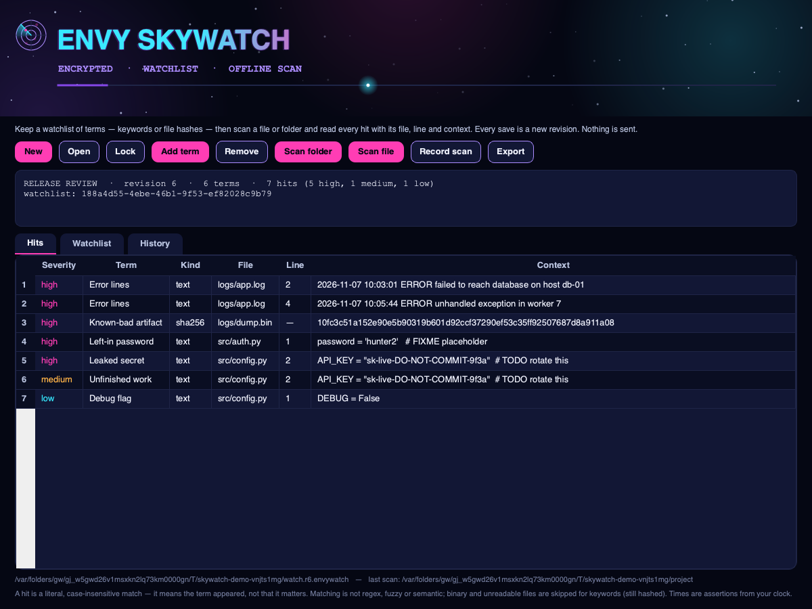
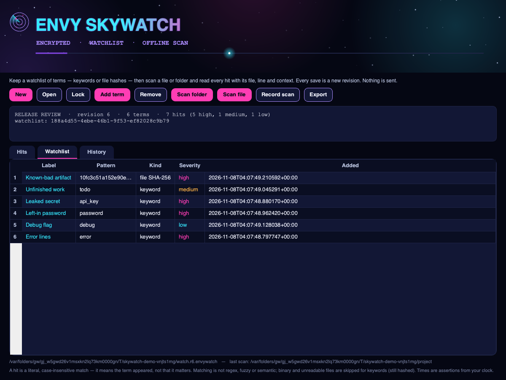

<p align="center">
  
</p>

<p align="center"><b>Keep an encrypted watchlist of what to watch for — keywords or file hashes — then scan a file or folder offline and read every hit with its file, line and context, in a real native app window.</b><br />
AES-256-GCM encrypted watchlists, a SHA-256 hash-chained scan journal, revision-preserving saves, and plaintext export. From ENVY BLACK VEIL, as a standalone app.</p>

<p align="center">
  <a href="https://github.com/xzchick/envy-skywatch/actions/workflows/tests.yml"></a>
</p>
<p align="center">
  
  
  <br />
  
  
  
  
</p>

<p align="center">
  <a href="#install"><b>Install</b></a> ·
  <a href="#works-on">Compatibility</a> ·
  <a href="#using-it">Using it</a> ·
  <a href="#honest-by-design">What it isn't</a> ·
  <a href="#build--test">Build</a>
</p>

<p align="center">
  
</p>

<p align="center"><sub>A real native window — not a browser view. The wordmark pulses, a radar sweeps the header, and a light travels the accent bar.</sub></p>

<a name="features"></a>




Keep the things you want to catch — leaked secrets, error lines, a left-in `TODO`, a known-bad file — each as a **term**: a case-insensitive **keyword**, or a file's **SHA-256**, with a severity you set. Point a **scan** at a file or a whole folder and SkyWatch reads each file locally and reports every **hit**: the term, the file, the line number and a trimmed context snippet (for keywords), or the matching file (for hashes), most severe first. The watchlist is sealed in the same **AES-256-GCM** envelope [ENVY Vault](https://github.com/xzchick/envy-vault) uses.

<p align="center">
  
</p>

The **Watchlist** tab manages your terms, and **recording a scan** appends its summary — files scanned, hits by severity — to a **SHA-256 hash-chained journal** as a new revision; the previous one is never overwritten. A plaintext HTML or JSON report can be exported whenever you choose. Everything is local.

<a name="works-on"></a>


<p align="center">
  
  
  
</p>



### Requirements

| | 🍎 macOS | 🪟 Windows | 🐧 Linux |
|---|---|---|---|
| **OS version** | macOS 11 Big Sur or newer | Windows 10 or 11 (64-bit) | A current x86_64 or arm64 desktop |
| **Standalone bundle** | Nothing else to install | Nothing else to install | Standard desktop libraries (X11 or Wayland) |
| **From pip** | Python 3.10+ | Python 3.10+ | Python 3.10+ and a desktop session |
| **Dependencies** | `cryptography` + Qt (bundled) | `cryptography` + Qt (bundled) | `cryptography` + Qt (bundled) |
| **Network** | None, ever | None, ever | None, ever |

<a name="install"></a>


A **standalone bundle** that needs no Python, or **pip** if you already have Python 3.10+.

### Standalone bundle (no Python)

Download a bundle from the [latest release](https://github.com/xzchick/envy-skywatch/releases/latest):

| File | System | Run it |
|---|---|---|
| `envy-skywatch-v0.1.0-macos-arm64.tar.gz` | macOS (Apple Silicon) | `tar -xzf` it, then open `envy-skywatch` |
| `envy-skywatch-v0.1.0-windows-x86_64.zip` | Windows (64-bit) | Unzip, then run `envy-skywatch.exe` |
| `envy-skywatch-v0.1.0-linux-x86_64.tar.gz` | Linux (64-bit) | `tar -xzf` it, then run `./envy-skywatch` |
| `envy_skywatch-0.1.0-py3-none-any.whl` | Any OS with Python 3.10+ | `pip install` the wheel |
| `SHA256SUMS.txt` | — | Verify your download first |

Running `envy-skywatch` with no arguments opens the window.

### From pip (Python 3.10+)

```sh
git clone https://github.com/xzchick/envy-skywatch.git
cd envy-skywatch
python3 -m venv .venv
. .venv/bin/activate          # Windows: .venv\Scripts\activate
pip install .
envy-skywatch                  # opens the window
```

<a name="using-it"></a>


**In the window**

- **New** → name the watchlist, set a passphrase (at least 12 characters).
- **Add term** → a keyword (case-insensitive) or a file SHA-256, with a severity.
- **Scan folder** / **Scan file** → fills the **Hits** tab with matches, coloured by severity, most severe first.
- **Record scan** → appends the scan's summary to the journal. **Remove** drops a term.
- **Export** → writes a plaintext HTML or JSON scan report.

**In the terminal**

```sh
envy-skywatch init review.envywatch --title "Release review"
envy-skywatch add review.envywatch review.r1.envywatch --label "Leaked secret" --pattern api_key --severity high
envy-skywatch scan review.r1.envywatch ./project        # what hit? (exit 1 if anything did)
envy-skywatch record review.r1.envywatch review.r2.envywatch ./project
envy-skywatch export review.r1.envywatch report.html ./project --format html
```

`scan` exits non-zero when there is any hit, so it drops straight into a pre-commit hook or a CI step. Every write is a new file; the watchlist is never overwritten.

<a name="honest-by-design"></a>


The watchlist and its journal are sealed with **AES-256-GCM** and a key derived from your passphrase with **scrypt**, and the scan journal is **hash-chained** so summaries cannot be reordered or edited without breaking the chain. What SkyWatch does **not** do is just as important:

- **A hit is a literal match, not a verdict.** It means the term appeared, not that it is a problem — you read the context and decide.
- **Matching is simple on purpose.** Case-insensitive substring only: not regex, not fuzzy, not semantic. It will miss an obfuscated or split secret, and flag an innocent mention.
- **It reads only what it can decode.** Binary and undecodable files are skipped for keywords (they are still hashed for file-hash terms), and very large or unreadable files are skipped entirely.
- **Times are assertions.** Scan and record times come from your machine's clock; the hash chain orders entries but does not establish a trusted time.
- **Nothing is sent.** No network, no accounts, no uploads. Every result is a new local file.

> [!IMPORTANT]
> Keep your passphrase safe. There is no recovery: without it, an encrypted watchlist cannot be opened.

<a name="build--test"></a>


```sh
python -m unittest discover -s tests -v          # unit tests (no display needed)
pip install pyinstaller build
python scripts/build_release_bundle.py           # standalone bundle + wheel + sdist + checksums
python scripts/smoke_test_release.py             # launch the built bundle and check it runs
```

CI runs all of this on Ubuntu, Windows and macOS for every push. Regenerate the README artwork with `python scripts/render_readme_art.py`.

<p align="center"><sub>MIT licensed. Part of ENVY BLACK VEIL, packaged as a standalone app. Offline; no telemetry, no network, no accounts.</sub></p>
